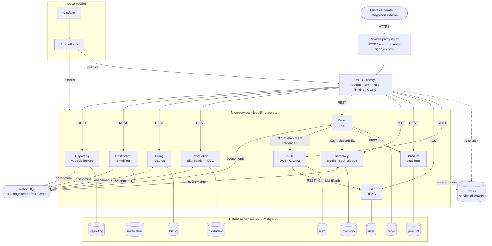

# Architecture – SFMC Bénin

## Diagramme de composants

### Règles d'architecture

| Règle | Application |
|---|---|
| DDD / bounded contexts | 1 service = 1 domaine (identité, utilisateurs, catalogue, stock, commandes, production, finance, communication, analyse) |
| Database per service | Chaque service a son propre conteneur PostgreSQL ; aucune requête SQL inter-services |
| Sync (REST) | Order → Product (prix), Order → Inventory (disponibilité), Auth → User (identifiants) ; résolus via Consul |
| Async (RabbitMQ) | Tous les changements d'état métier sont publiés en événements ; consommateurs idempotents, ré-essais puis dead-letter |
| Sécurité | JWT vérifié à la Gateway **et** dans chaque service (défense en profondeur) ; RBAC par `@Roles()` |
| Observabilité | `/health`, `/metrics`, logs JSON avec `correlationId` propagé en HTTP (`x-correlation-id`) et dans les événements |

## Catalogue d'événements

| Événement | Publié par | Consommé par |
|---|---|---|
| `OrderCreated` | Order | Inventory, Notification, Reporting |
| `StockReserved` | Inventory | Order, Reporting |
| `StockInsufficient` | Inventory | Order, Notification, Reporting |
| `ProductionRequested` | Order | Production, Reporting |
| `ProductionCompleted` | Production | Inventory, Order, Notification, Reporting |
| `ProductionFailed` | Production | Order, Reporting |
| `StockUpdated` | Inventory | Reporting |
| `StockLow` (seuil critique) | Inventory | Notification, Reporting |
| `OrderValidated` | Order | Billing, Notification, Reporting |
| `InvoiceIssued` | Billing | Order, Notification, Reporting |
| `InvoicePaid` | Billing | Notification, Reporting |
| `OrderShipped` | Order | Inventory (sortie de stock), Notification, Reporting |
| `OrderRejected` / `OrderCancelled` | Order | Inventory (libération), Billing (annulation facture), Notification, Reporting |
| `StockReleased` | Inventory | Reporting |
