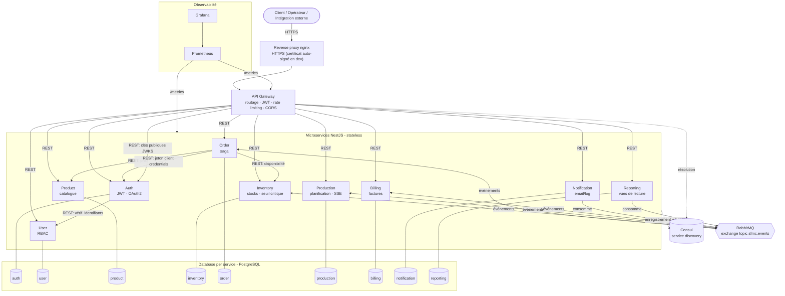
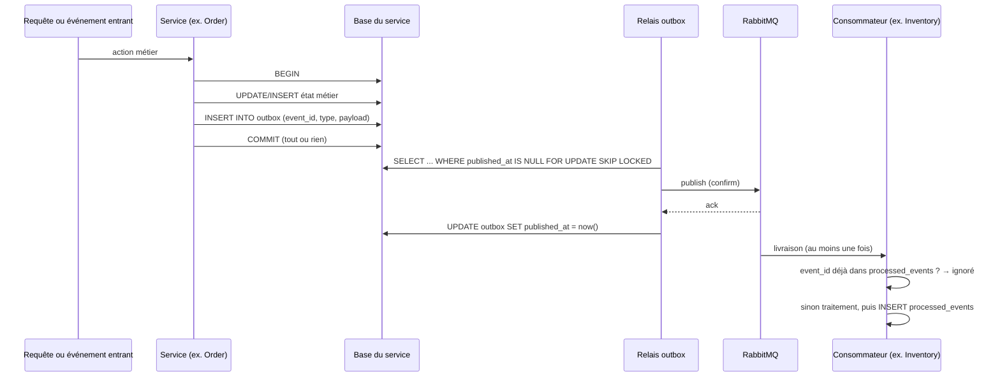

# Architecture – SFMC Bénin

## Diagramme de composants

### Règles d'architecture

| Règle | Application |
|---|---|
| DDD / bounded contexts | 1 service = 1 domaine (identité, utilisateurs, catalogue, stock, commandes, production, finance, communication, analyse) |
| Database per service | Chaque service a son propre conteneur PostgreSQL ; aucune requête SQL inter-services |
| Sync (REST) | Order → Product (prix), Order → Inventory (disponibilité), Auth → User (identifiants) ; résolus via Consul |
| Async (RabbitMQ) | Tous les changements d'état métier sont publiés en événements via une **outbox transactionnelle** ; consommateurs dédupliqués par identifiant d'événement, ré-essais puis dead-letter |
| Sécurité | Jetons RS256 signés par Auth seul (clé privée) ; vérifiés à la Gateway **et** dans chaque service avec la clé publique (JWKS, mise en cache, rechargée en cas de clé inconnue) ; RBAC par `@Roles()` |
| Observabilité | `/health`, `/metrics`, logs JSON avec `correlationId` propagé en HTTP (`x-correlation-id`) et dans les événements |

## Publication fiable des événements (outbox)

Un service ne publie jamais directement sur RabbitMQ. Le changement d'état et les événements qu'il produit sont écrits **dans la même transaction** PostgreSQL (table `outbox`) : soit les deux existent, soit aucun. Un relais, dans chaque instance du service, publie ensuite les lignes en attente dans l'ordre, avec confirmation du broker, et ne les marque publiées qu'après cette confirmation.

| Situation | Comportement |
|---|---|
| RabbitMQ arrêté | Les requêtes sont acceptées ; les événements attendent dans l'outbox (`/health` : `degraded`, `outboxPending`) et partent au retour du broker |
| Crash du service après le commit | L'événement est en base ; le relais le publie au redémarrage (ou une autre réplique le fait) |
| Crash entre la publication et le marquage | L'événement est republié : le consommateur le reconnaît par son identifiant et l'ignore |
| Plusieurs répliques | `FOR UPDATE SKIP LOCKED` : chaque ligne est relayée par une seule instance à la fois |

Purge : lignes publiées et traces de déduplication supprimées après `OUTBOX_RETENTION_DAYS` (7 jours par défaut).

## Contrats des événements

Chaque événement a un **contrat** (`packages/common/src/contracts.ts`) : champs, types (UUID, date ISO, entier, valeurs autorisées), champs obligatoires ou facultatifs.

- **Compilation** : le contrat doit lister exactement les champs de l'interface TypeScript de l'événement ; un oubli ou un champ inventé empêche la compilation.
- **Envoi** : l'outbox refuse un événement non conforme, la transaction est annulée ; rien de mal formé ne part.
- **Réception** : un message non conforme est envoyé directement en dead-letter (`sfmc.dead-letters`), avec un log qui explique l'écart, au lieu d'être ré-essayé.
- **Évolution** : un champ supplémentaire est toléré à la réception ; on peut donc ajouter un champ à un événement sans casser ses consommateurs. Supprimer ou renommer un champ exige de mettre à jour d'abord les consommateurs.
- `npm run test:contracts` vérifie que le tableau ci-dessous correspond au code (producteurs et consommateurs lus dans les services) ; il fait échouer la CI si la documentation dérive.

## Catalogue d'événements

| Événement | Publié par | Consommé par |
|---|---|---|
| `OrderCreated` | Order | Inventory, Notification, Reporting |
| `StockReserved` | Inventory | Order, Reporting |
| `StockInsufficient` | Inventory | Order, Notification, Reporting |
| `ProductionRequested` | Order | Production, Reporting |
| `ProductionCompleted` | Production | Inventory, Order, Notification, Reporting |
| `ProductionFailed` | Production | Order, Notification (alerte équipe), Reporting |
| `StockUpdated` | Inventory | Reporting |
| `StockLow` (seuil critique) | Inventory | Notification, Reporting |
| `OrderValidated` | Order | Billing, Notification, Reporting |
| `InvoiceIssued` | Billing | Order, Notification, Reporting |
| `InvoicePaid` | Billing | Notification, Reporting |
| `OrderShipped` | Order | Inventory (sortie de stock), Notification, Reporting |
| `OrderRejected` / `OrderCancelled` | Order | Inventory (libération), Billing (annulation facture), Notification, Reporting |
| `StockReleased` | Inventory | Reporting |
