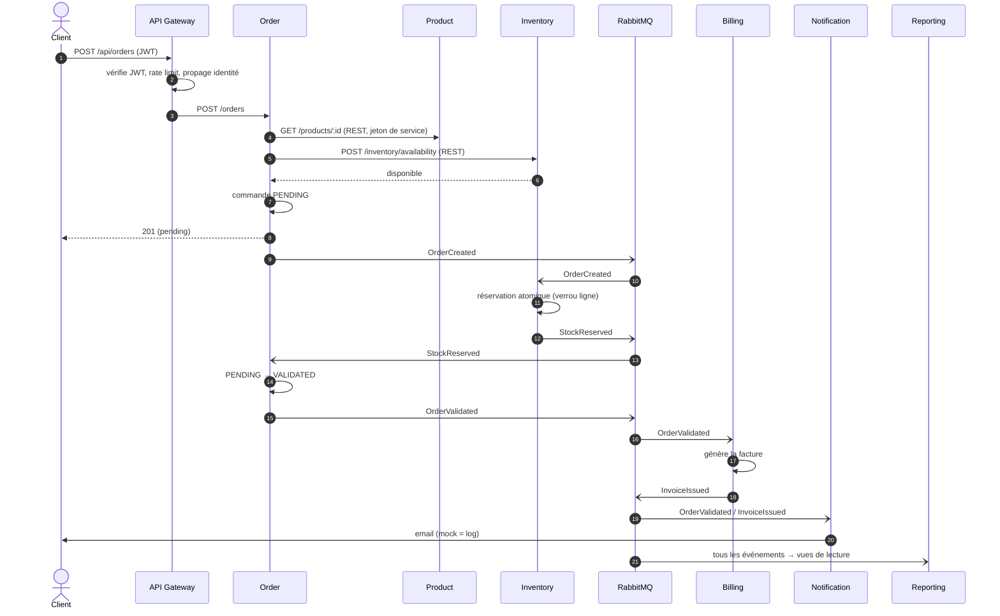
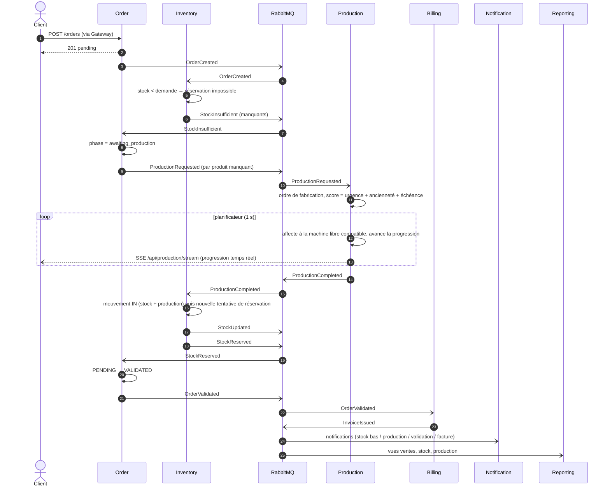
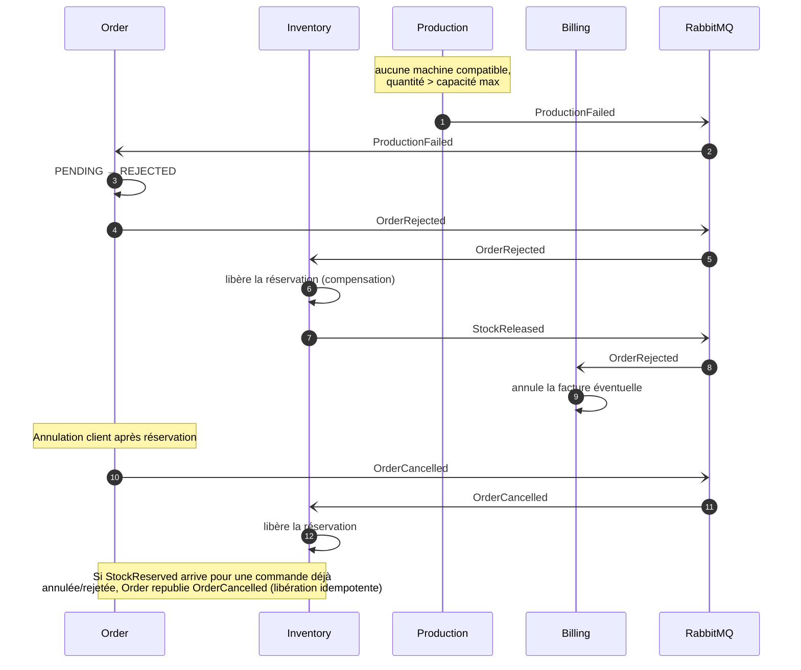
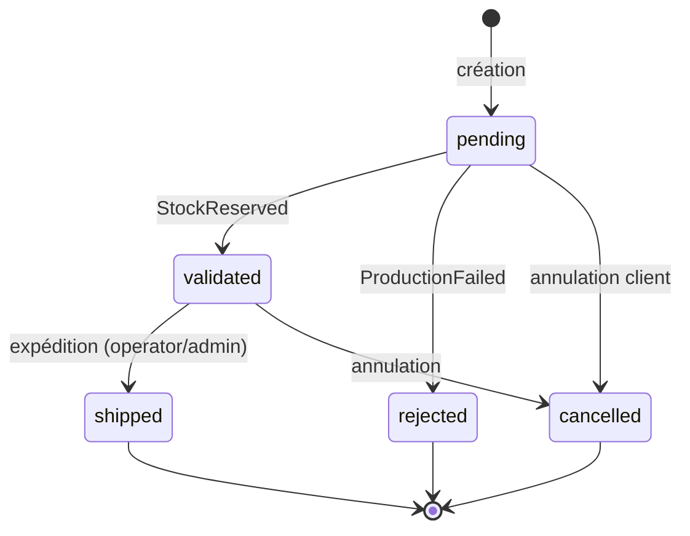

# Flux commande – Saga par chorégraphie

Aucun orchestrateur central : chaque service réagit aux événements des autres. La cohérence est **éventuelle**.

Dans les diagrammes ci-dessous, « publie » signifie : écrit dans l'outbox du service dans la même transaction que le changement d'état, puis relayé vers RabbitMQ (voir [01-architecture.md](01-architecture.md#publication-fiable-des-événements-outbox)). Une panne du broker ou un crash ne fait donc perdre aucune étape de la saga.

## Cas nominal – stock disponible

## Cas stock insuffisant – production déclenchée

## Compensations (échec)

## Cycle de vie d'une commande

La sous-phase `awaiting_stock` / `awaiting_production` est portée par le champ `phase` d'une commande `pending`.
