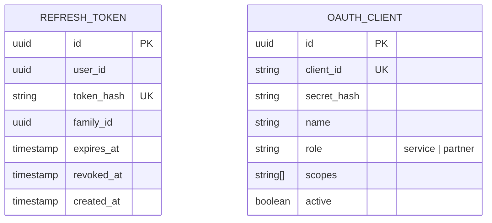
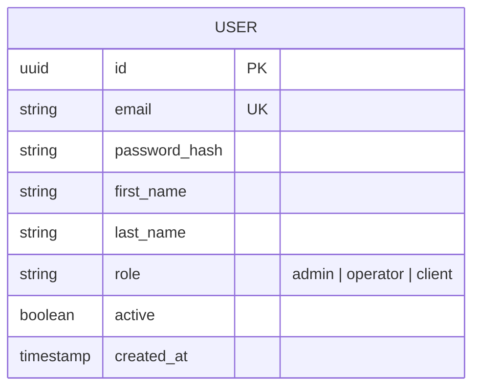
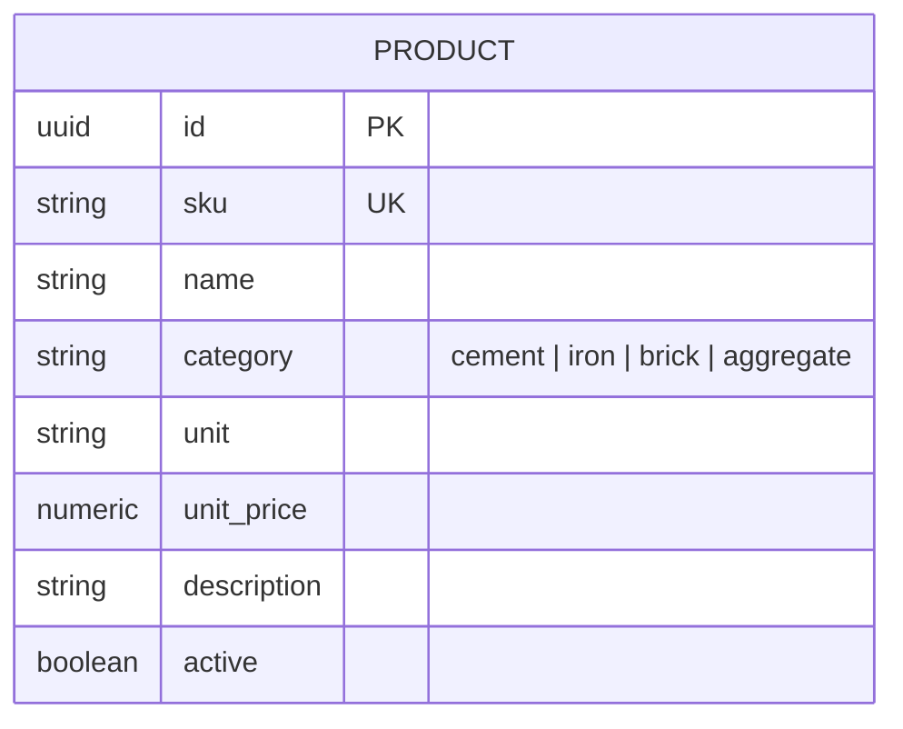
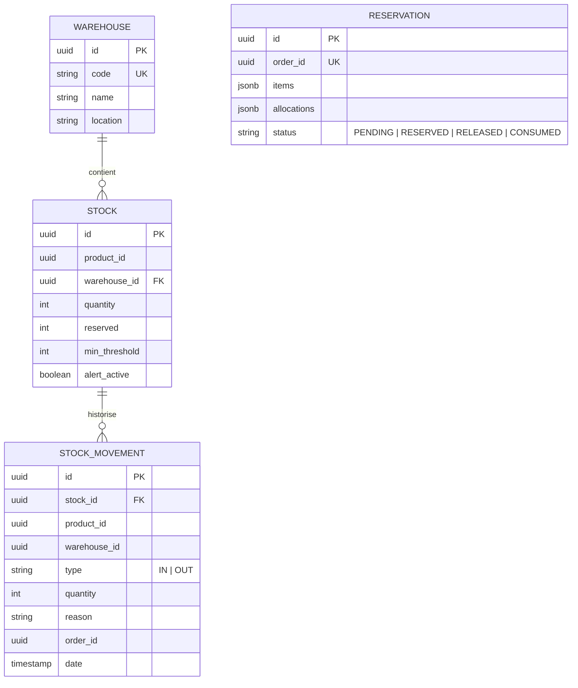
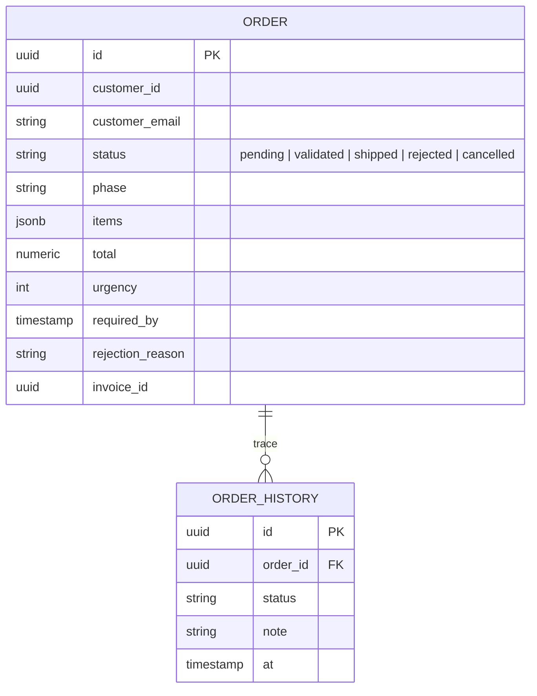
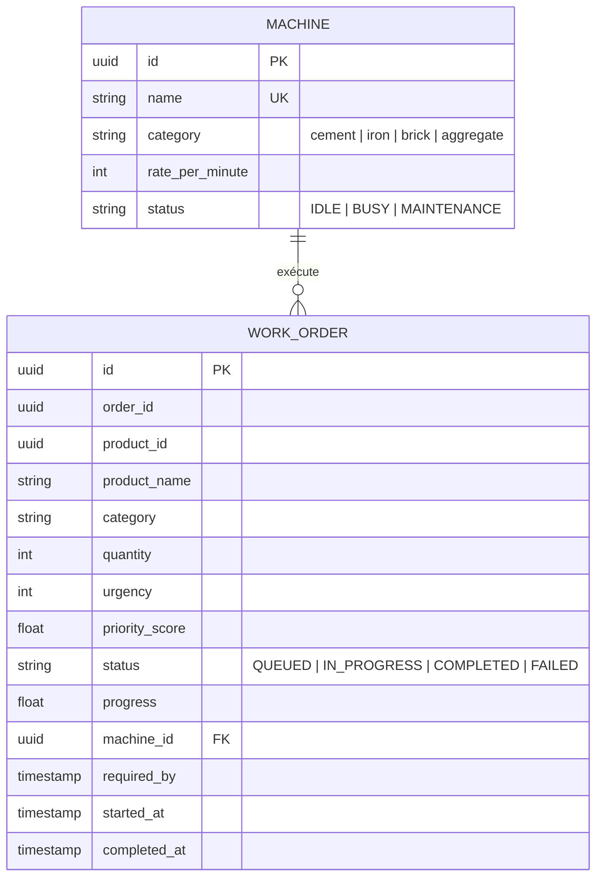
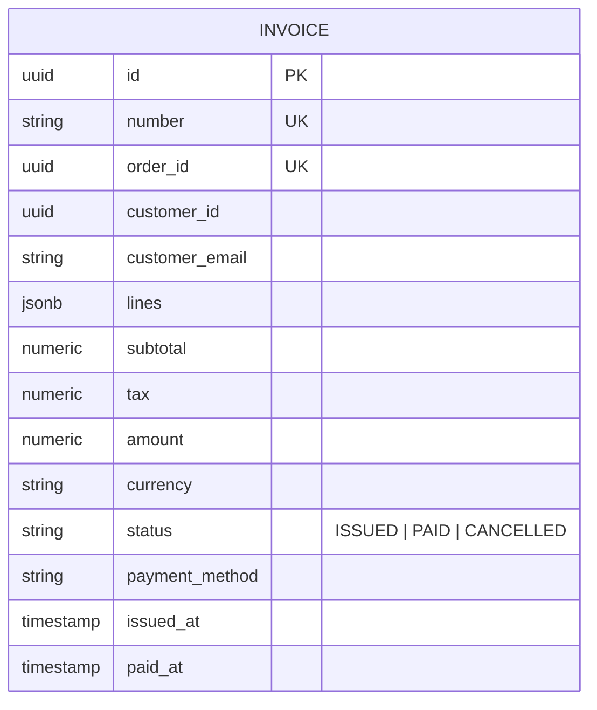
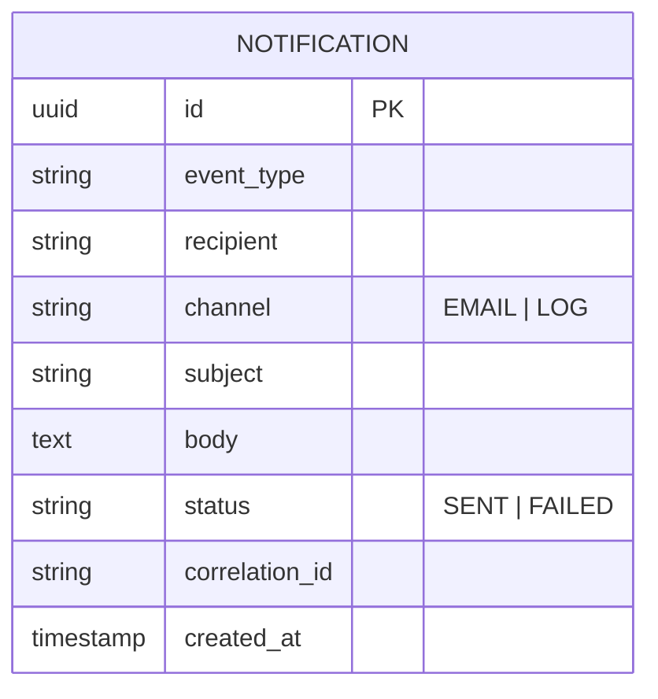
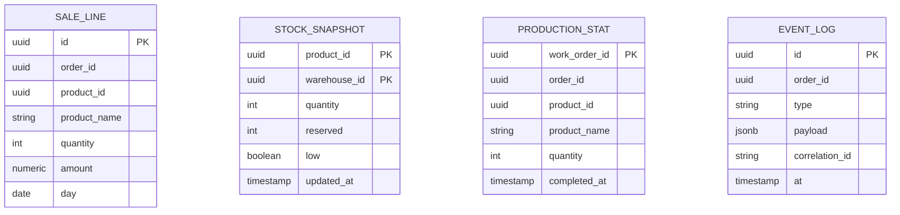

# Schémas de données par service

Le schéma de chaque base est défini par les entités TypeORM et créé par les migrations versionnées du service (`services/<service>/src/migrations`, table de suivi `migrations`). Billing possède en plus la séquence `invoice_number_seq` (numérotation des factures).

Chaque service possède sa base PostgreSQL. Les références entre services (`product_id`, `customer_id`, `order_id`) sont de simples identifiants, sans clé étrangère entre bases.

## Auth

## User

## Product

## Inventory

## Order

## Production

## Billing

## Notification

## Reporting (modèles de lecture)

